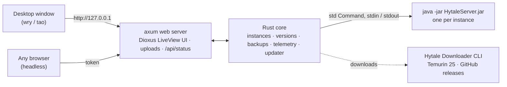

<div align="center">


# HyOrchestrator

**Run and manage Hytale servers from one place: a desktop app on your PC, a web panel on your headless server.**

HyOrchestrator downloads the official Hytale server for you, runs as many isolated server instances as your
machine handles, and gives you live telemetry, a console, worlds with seeds, operators, drag & drop mods,
1-click updates and backups. Written in pure Rust, front to back.


[](https://github.com/Akulav/hytale-server-orchestrator/releases/latest)
[](https://github.com/Akulav/hytale-server-orchestrator/actions/workflows/build.yml)

[**Download**](https://github.com/Akulav/hytale-server-orchestrator/releases/latest) ·
[Quick start](#-quick-start) ·
[Features](#-features) ·
[Building](#%EF%B8%8F-building-from-source) ·
[Changelog](CHANGELOG.md)

</div>

---

## Contents

- [Why it's different](#-why-its-different) · [Features](#-features) · [Screenshots](#%EF%B8%8F-screenshots)
- [Quick start](#-quick-start) · [What you need](#-what-you-need)
- [Installing, updating and uninstalling](#-installing-updating-and-uninstalling)
- [Desktop, headless and the command line](#%EF%B8%8F-desktop-headless-and-the-command-line) · [How it works](#%EF%B8%8F-how-it-works)
- [Tech stack](#-tech-stack) · [Privacy and safety](#-privacy-and-safety)
- [Building from source](#%EF%B8%8F-building-from-source) · [Versions and releases](#%EF%B8%8F-versions-and-releases) · [Tests](#-tests)
- [Project layout](#%EF%B8%8F-project-layout) · [Troubleshooting](#-troubleshooting) · [License](#-license)

---

## ✨ Why it's different

|  |  |
|---|---|
| 🖥️ **Desktop or headless, same app** | With a screen it opens a window. Over SSH on a Linux box it serves the very same UI as a web panel and prints the link. |
| 🦀 **Pure Rust** | Backend (tokio, axum) and UI (Dioxus) are Rust. One small program; no Node, no Docker, no Python. |
| 📦 **Official server files** | Uses Hypixel's own Hytale Downloader CLI under your Hytale account, or the files of your installed launcher. |
| 🔄 **Keeps everything current** | 1-click server updates (with a backup first) and an in-app updater for HyOrchestrator itself. |
| 🧱 **Isolated instances** | Each server has its own folder, version, port, worlds, mods, operators and backups. |

## 🎀 Features

| Area | What it does |
|---|---|
| **Instances** | Create any number of servers: name, version, UDP port (conflicts are caught), RAM, update channel, offline auth for LAN tests, extra JVM / server arguments, auto-restart after crashes. |
| **Versions** | Download the latest `release` or `pre-release` with the official downloader, import from the Hytale launcher or a zip / folder. Every instance can run any cached version and switch up or down. |
| **Worlds** | Generate any number of worlds per instance with a chosen or random seed (numbers or words), see their size, toggle PvP, delete. |
| **Players & rights** | Online players read live from the console; make or remove operators (`/op add`, `/op remove`), kick. |
| **Mods** | Drag & drop `.jar` / `.zip` mods onto an instance (or pick files), enable / disable with a switch, remove. |
| **Telemetry** | Machine CPU and RAM, and per server CPU, RAM, players online and uptime, with live charts. |
| **Console** | Live output with a filter, a command line, quick commands, clickable Hytale login links and a login helper. |
| **Updates** | 1-click: backup → download the latest server of the instance's channel → swap → restart. |
| **Backups** | "World + mods" zips (universe, mods, config, permissions, whitelist, bans), labelled, restorable in one click with a safety backup first. |
| **Java** | Detects Java 25 and installs Eclipse Temurin 25 in one click if it is missing. |
| **Comfort** | Dark glass UI, task list with progress and logs, `/api/status` JSON for your own scripts, "Made by Akulav". |

## 🖼️ Screenshots

> [!NOTE]
> Screenshots are coming with the first release (they go in `docs/`): the dashboard with live machine and
> server telemetry, an instance's overview / console / worlds / mods tabs, and the headless banner.

| Page | What you see |
|---|---|
| **Dashboard** | Machine CPU / RAM charts, servers running, players online, one live card per instance with Start / Stop |
| **Instance** | Status, Stop / Restart / Kill / Update / Back up, tabs: Overview · Console · Worlds · Players · Mods · Backups · Settings |
| **Server versions** | Downloader buttons, launcher import, zip / folder import, the version cache |

## 🚀 Quick start

1. **Download** the file for your system from the [latest release](https://github.com/Akulav/hytale-server-orchestrator/releases/latest)
   and install it (see [below](#-installing-updating-and-uninstalling)).
2. **Start HyOrchestrator.** No Java 25? Click **Install Java 25 (Temurin)** on the dashboard.
3. **Server versions → Latest release.** HyOrchestrator fetches Hypixel's official downloader by itself. The first
   time a **Sign in to Hytale** card appears with a code: click **Open sign-in page** (the desktop app opens it for
   you), approve with the account that owns Hytale, and the download continues by itself. No token to paste; the
   login is saved. (Or **Import** the files of your installed Hytale launcher.)
4. **New instance** → name, version, port, seed → **Create** → **Start**.
5. First start only: the server must be signed in too. HyOrchestrator starts the sign-in by itself and shows the
   same card on the instance page; approve it once and the login is saved for restarts. Players then join on
   `your-ip:5520` (UDP).

> [!TIP]
> On a Linux server without a display, just run `./hyorchestrator-linux-x64-headless`: it prints a link like
> `http://192.168.1.20:7520/?token=…`. Open it from any browser on your network.

## 🧰 What you need

| | Minimum | Comfortable |
|---|---|---|
| **RAM** | 4 GB per Hytale server (Hypixel's figure) + ~100 MB for HyOrchestrator | 8 GB+ per busy server |
| **Disk** | ~4 GB per server version + your worlds and backups | an SSD |
| **Java** | Java 25 (installed for you on request) | |
| **OS** | Windows 10/11 x64; Linux x86-64 (WebKitGTK 4.1 for the desktop build, nothing for headless); macOS 11+ on Apple Silicon | |
| **Network** | Internet for downloads; UDP port forwarding for players outside your network | |

## 📦 Installing, updating and uninstalling

| System | File | Where it lives | Shortcuts |
|---|---|---|---|
| Windows | `HyOrchestrator-setup.exe`: a wizard with a license page, a **folder you can change** and a **desktop icon** choice; per user, no admin rights | `%LOCALAPPDATA%\HyOrchestrator` (data in `data\`) | Start menu (+ "headless web UI"), desktop, *Settings → Apps* |
| macOS | `HyOrchestrator-macos-arm64.dmg`: drag HyOrchestrator to Applications | data in `~/Library/Application Support/HyOrchestrator/data` | Applications |
| Linux | `hyorchestrator-linux-x64` (window) or `hyorchestrator-linux-x64-headless` (web only): `chmod +x` and run | data in `~/.local/share/HyOrchestrator/data` | - |

**Updating.** HyOrchestrator checks GitHub 15 seconds after it starts and every 6 hours (Settings can turn that
off), or when you press **About → Check for updates**. **Download & install** fetches this system's file, checks it
against the release's `SHA256SUMS.txt` (a mismatch changes nothing), stops your servers cleanly and then:

- **Windows:** runs `HyOrchestrator-setup.exe` silently on your install folder; it replaces the program and starts it.
  Running a newer setup by hand also finds the previous install folder by itself.
- **Linux / macOS:** swaps the program in place (the old one is kept until the next start) and starts it again
  with the same options.

| Written by an update | Never touched |
|---|---|
| The program (and on Windows its shortcuts and Apps entry) | `data/`: instances, worlds, mods, versions, backups, Java, settings |

**Uninstalling.** Windows: *Settings → Apps → HyOrchestrator*; it asks whether to delete the data too (default:
keep). macOS / Linux: delete the program and, if you want, the data folder above.

## 🛰️ Desktop, headless and the command line

HyOrchestrator always runs a small web server for its UI. With a display it shows that UI in a native window
(bound to `127.0.0.1` only); without one (Linux with no `DISPLAY` / `WAYLAND_DISPLAY`, a Mac over SSH, or
`--headless`) it listens on all interfaces and prints:

```
 ────────────────────────────────────────────────────────────────────
  HyOrchestrator 0.1.0 · Made by Akulav
  Headless mode: the web UI is served here instead of a window.
 ────────────────────────────────────────────────────────────────────
  Local:    http://127.0.0.1:7520/?token=4f9c…
  Network:  http://192.168.1.20:7520/?token=4f9c…
 ────────────────────────────────────────────────────────────────────
```

Every page needs the token (it becomes a cookie after the first visit). In the desktop window, **Open in browser**
in the sidebar opens the same UI in your browser.

| Option | |
|---|---|
| `--headless` | web UI only (default without a display) |
| `--desktop` | force the window |
| `--port <n>` | web UI port (default `7520`, or Settings) |
| `--host <ip>` | listen address (headless `0.0.0.0`, desktop `127.0.0.1`) |
| `--data-dir <path>` | where instances, versions and backups live |
| `--print-url` | print the access links and quit |
| `--version`, `--help` | |

Run it as a service on Linux, for example with systemd:

```ini
[Service]
ExecStart=/opt/hyorchestrator/hyorchestrator-linux-x64-headless --data-dir /srv/hyorchestrator
User=hytale
Restart=on-failure
KillSignal=SIGTERM
TimeoutStopSec=90
```

## 🏗️ How it works



- **The UI** is a Dioxus component tree rendered on the server (LiveView): the browser or the window only shows it
  over a WebSocket. Drag & drop uploads go straight to `POST /api/instances/<id>/mods`.
- **A server** is `java [-Xms -Xmx -XX:AOTCache] -jar HytaleServer.jar --assets <version>/Assets.zip --bind 0.0.0.0:<port>`
  in its instance folder, with `HYTALE_DISABLE_UPDATES=1` (HyOrchestrator handles updates). Commands go to its
  stdin; players, login prompts and the boot line are read from its output. **Stop** sends `/stop` and waits up to
  45 s before killing it.
- **Versions** live once in `data/versions/<version>` (`Server/` + `Assets.zip`); each instance copies `Server/` and
  points `--assets` at the shared Assets.zip.

## 🦀 Tech stack

| Layer | Crates / tools |
|---|---|
| Runtime | `tokio` |
| Web server / API | `axum` (WebSocket, multipart) |
| UI | `dioxus` 0.7 + `dioxus-liveview` (Rust components rendered server-side) |
| Desktop window | `tao` + `wry` (WebView2 / WKWebView / WebKitGTK), `muda` (macOS menu) |
| Processes | `std::process::Command` (driven through `tokio::process`) |
| Telemetry | `sysinfo` |
| Data | `serde`, `serde_json` (settings, instances), `zip` (backups, downloads) |
| Downloads & updates | `reqwest` (rustls), `sha2` |
| Packaging | Inno Setup 6 (Windows), `.app` + `.dmg` (macOS), GitHub Actions |

## 🔒 Privacy and safety

- Everything stays on your machine. HyOrchestrator talks to the internet only to download the Hytale downloader /
  server files (Hypixel), Temurin Java (Adoptium) and its own updates (GitHub).
- The web UI requires a random 256-bit token; cookies are `HttpOnly; SameSite=Strict` and cross-origin requests are
  refused. Desktop mode listens on `127.0.0.1` only unless you allow the network in Settings.
- Uploaded mods are checked (name, `.jar` / `.zip`, zip signature) and land only in that instance's `mods/` folder.
- Updates install only files whose SHA-256 matches the release's `SHA256SUMS.txt`.

## 🛠️ Building from source

**Windows:** double-click **`run.bat`**: it builds the program and (if Inno Setup 6 is installed) the setup, copies
them to `dist\` and starts HyOrchestrator.

| Command | What it does |
|---|---|
| `run.bat` | build program + setup → `dist\` → launch |
| `run.bat build` | the same without launching |
| `run.bat quick` | program only, then launch |
| `run.bat headless` | build, then run the web UI only |

**By hand, any system:**

```bash
cargo build --release                         # desktop + web → target/release/hyorchestrator(.exe)
cargo build --release --no-default-features   # headless only (no GUI libraries)
```

Linux desktop builds need `libwebkit2gtk-4.1-dev libgtk-3-dev` (Ubuntu). Icons are drawn by
`scripts/make-icons.ps1`. A copy built from source never replaces itself with a download.

## 🏷️ Versions and releases

`Cargo.toml` holds the version; the setup script and `Info.plist` follow it. Note changes under `[Unreleased]` in
[CHANGELOG.md](CHANGELOG.md), then:

```powershell
scripts\bump-version.ps1            # patch, or: minor | major | 1.2.3
git commit -am "Release vX.Y.Z: what changed"
git push                            # or push from GitHub Desktop
```

A push to `main` with a version that has no release yet makes the **Build** workflow run the checks, build on
GitHub's Windows, Linux and macOS runners, create the tag `vX.Y.Z` and publish:

| File | |
|---|---|
| `HyOrchestrator-setup.exe` | Windows setup; also what an update runs |
| `hyorchestrator-linux-x64` | Linux program with the desktop window |
| `hyorchestrator-linux-x64-headless` | Linux program, web UI only |
| `hyorchestrator-macos-arm64` | macOS program; what an update downloads |
| `HyOrchestrator-macos-arm64.dmg` | HyOrchestrator.app for a first install |
| `SHA256SUMS.txt` | checksums of all of the above |

## 🧪 Tests

```bash
cargo test                                        # unit tests: parsing, zips, worlds, mods, updater, web auth…
cargo clippy --all-targets -- -D warnings
cargo clippy --all-targets --no-default-features -- -D warnings
```

## 🗂️ Project layout

```
run.bat, scripts/            one-click build, version bump, icon generator
.github/workflows/build.yml  checks on 3 systems → release builds → tag + release
installer/                   hyorchestrator.iss (Windows setup), Info.plist (macOS app)
assets/                      logo, icons, style.css, app.js (drag & drop) - embedded in the program
src/                         the Rust program (see CLAUDE.md for a file-by-file map)
```

## 🩺 Troubleshooting

| Problem | What to do |
|---|---|
| "Java 25 or newer is required" | Dashboard or Settings → **Install Java 25 (Temurin)**, or set the path to your own Java 25. |
| Players can't connect | Forward / allow **UDP** (not TCP) on the instance's port. On the server, check the **Log in** banner: an unauthenticated server rejects players. |
| The server forgets its login after a restart | HyOrchestrator sends `/auth persistence Encrypted` after each sign-in; use **Sign in again** on the instance page, or type it in the console. |
| The sign-in code expired | Start the download again (or **Sign in again** for a server): a new code appears. Server versions → **Sign out** forgets the downloader's saved login. |
| The player list stays empty | The console wording may differ in your Hytale version: set your own join / leave patterns in Settings. |
| Downloader on a Mac | Hypixel ships it for Windows and Linux only: use **Import from your Hytale launcher**. |
| Linux: "cannot create the web view" | Install WebKitGTK 4.1, or use the `-headless` build / `--headless`. |
| macOS: "HyOrchestrator can't be opened" | Right-click it in Applications → *Open* (the app is signed ad hoc). |
| Forgot the web link | `hyorchestrator --print-url`, or Settings → Web UI in the desktop window. |

## 📄 License

HyOrchestrator is **source-available**, not open source: you may use the releases, read the code and modify it
privately, but not redistribute it or use it commercially. See [LICENSE](LICENSE). Third-party components keep
their own licenses. Hytale is a trademark of Hypixel Studios; HyOrchestrator is not affiliated with them.

---

<div align="center">


**Made by [Akulav](https://github.com/Akulav)**

</div>
