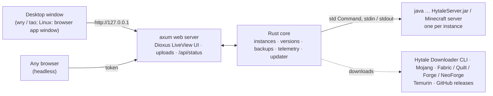

<div align="center">


# Hyve

**Run and manage Hytale and Minecraft servers from one place, made by Akulav.**

A desktop app on your PC, a web panel on your headless server. No telemetry. No bloat. One file per system that installs and updates itself.

[](https://github.com/Akulav/hytale-server-orchestrator/releases/latest)
[](https://github.com/Akulav/hytale-server-orchestrator/releases)
[](https://github.com/Akulav/hytale-server-orchestrator/actions/workflows/build.yml)


### [⬇ Download the latest release](https://github.com/Akulav/hytale-server-orchestrator/releases/latest)

<sub>Formerly <i>HyOrchestrator</i> - installed copies update into Hyve by themselves, keeping their folder and data.</sub>

</div>

---

## ⬇️ Download

One file per system. The same file installs Hyve the first time and updates it later.

| Platform | File | Notes |
| :-- | :-- | :-- |
| 🪟 **Windows 10 / 11** (x64) | [`Hyve-setup.exe`](https://github.com/Akulav/hytale-server-orchestrator/releases/latest/download/Hyve-setup.exe) | Asks where to install. No admin rights needed. |
| 🐧 **Linux** (x64) | [`hyve-linux-x64`](https://github.com/Akulav/hytale-server-orchestrator/releases/latest/download/hyve-linux-x64) | Desktop and headless in one; no system libraries needed |
| 🍎 **macOS** (Apple Silicon) | [`hyve-macos-arm64`](https://github.com/Akulav/hytale-server-orchestrator/releases/latest/download/hyve-macos-arm64) | macOS 11+ |

Every release also ships `SHA256SUMS.txt` so you can verify your download.

## ✨ Features

<table>
<tr>
<td width="50%" valign="top">

### 🎮 Servers
- **Hytale** (official files via Hypixel's downloader or your launcher) and **Minecraft Java**: vanilla,
  **Fabric, Quilt, Forge, NeoForge**.
- Any number of isolated instances: own folder, version, port, RAM, worlds with seeds, mods, operators.
- Live console with commands, sign-in helper and a `server.properties` editor.

</td>
<td width="50%" valign="top">

### 🧰 Manage
- **1-click server updates** with a backup first; switch versions up or down.
- World + mods **backups**, restorable in one click (with a safety backup first).
- Drag & drop mods, enable / disable with a switch; Java installed for you when missing.

</td>
</tr>
<tr>
<td width="50%" valign="top">

### ⚡ Fast & light
- Pure Rust front to back (tokio, axum, Dioxus). No Node, no Docker, no Python.
- **Desktop or headless, same app**: with a screen it opens a window; over SSH it serves the UI as a web panel.
- Live machine and per-server CPU, RAM and player charts.

</td>
<td width="50%" valign="top">

### 🔄 Always up to date
- **You choose the install folder** once; Hyve and all its servers, versions and backups live there.
- **One-click updates** from GitHub, verified with SHA-256, into the same folder.
- Checks at start and every 6 hours (can be turned off in Settings).

</td>
</tr>
</table>

## 🚀 Getting started

### Windows
1. Download **`Hyve-setup.exe`** and run it.
2. Pick the install folder (default `%LOCALAPPDATA%\Hyve`, any folder you can write to works, e.g. `D:\Servers\Hyve`).
   It adds Start-menu and (optional) Desktop shortcuts and an entry in *Settings → Apps*.
3. Updates install into the same folder without asking: in-app with one click, or by running a newer setup.

Uninstall from *Settings → Apps*. The uninstaller asks whether to keep your servers, worlds and backups.

### Linux
```bash
chmod +x hyve-linux-x64
./hyve-linux-x64
```
With a display it asks for an install folder (default `~/.local/share/Hyve`), copies itself there and adds an app-menu
entry with icon and a `hyve` terminal command. *Just run it* skips installing. Over SSH:
`./hyve-linux-x64 --install --install-dir /srv/hyve`. Without a display it prints a link like
`http://192.168.1.20:7520/?token=…` to open from any browser on your network.
Running a newer download later offers to update the installed copy in its folder.
Uninstall with `hyve --uninstall` (add `--delete-data` to remove servers and backups too).

### macOS (Apple Silicon)
```bash
chmod +x hyve-macos-arm64
xattr -d com.apple.quarantine hyve-macos-arm64
./hyve-macos-arm64
```
It asks for an install folder (default `~/Applications/Hyve`) and creates `Hyve.app` there.

### Your first server
1. **Hytale:** *Server versions → Latest release* (sign in once with the account that owns Hytale), then
   **New instance → Create → Start**. *Settings → Hytale account → Sign in* once and every server starts signed in.
2. **Minecraft:** **New instance → Minecraft**, pick the software and version, accept the EULA → **Create → Start**.
3. Players join on the address in **Connect** (Hytale: UDP, Minecraft: TCP).

## 📁 Where your data lives

**In the install folder you chose**, in `data/` next to the program. Install on `D:\Servers\Hyve` and every server,
world, version, backup and Java runtime goes to `D:\Servers\Hyve\data`. The folder is remembered (Windows: by the
setup; Linux/macOS: in `~/.config/Hyve/install-dir` or `~/Library/Application Support/Hyve/install-dir`), so updates
keep everything in place. Data from older versions (`%LOCALAPPDATA%\Hyve\data`, `~/Library/Application Support/Hyve/data`)
is moved in, also when the install folder is on another drive.

| Path | Contents |
| :-- | :-- |
| `data/settings.json`, `data/instances.json` | settings and the list of servers |
| `data/instances/<id>/` | each server's folder (worlds, mods, configs) |
| `data/versions/`, `data/minecraft/` | cached Hytale versions and Minecraft server jars |
| `data/backups/` | world + mods backups |
| `data/java*/` | Java runtimes Hyve installed |
| `data/logs/`, `data/tmp/`, `data/updates/` | logs, temporary files, a downloaded update |
| `data/hytale-account.json` | saved Hytale sign-in (owner-only on Linux/macOS) |

`--data-dir <path>` puts the data anywhere else (e.g. for a systemd service).

## 🖥️ Command line

| Flag | Meaning |
| :-- | :-- |
| `--headless` | Web UI only (default without a display) |
| `--desktop` | Force the window |
| `--port <n>` / `--host <ip>` | Web UI port (default `7520`) and listen address |
| `--data-dir <path>` | Where instances, versions and backups live |
| `--print-url` | Print the access links and quit |
| `--install [--install-dir <path>]` | Linux / macOS: install into a folder (default as above) |
| `--uninstall [--delete-data]` | Linux / macOS: remove the program (and the data) |
| `--version`, `--help` | |

Run it as a service on Linux, for example with systemd:

```ini
[Service]
ExecStart=/srv/hyve/hyve --headless
User=hytale
Restart=on-failure
KillSignal=SIGTERM
TimeoutStopSec=90
```

## 🩺 Troubleshooting

| Problem | What to do |
| :-- | :-- |
| "Java 25 or newer is required" | Dashboard or Settings → **Install Java 25 (Temurin)**, or set the path to your own Java 25. |
| Players can't connect | Forward / allow **UDP** (Hytale) or **TCP** (Minecraft) on the instance's port. Check the **Log in** banner: an unauthenticated Hytale server rejects players. |
| The sign-in code expired | Start the download again (or **Sign in again** for a server): a new code appears. |
| Downloader on a Mac | Hypixel ships it for Windows and Linux only: use **Import from your Hytale launcher**. |
| Linux: the UI opens as a browser tab | Install Chrome, Chromium, Edge or Brave for a separate app window, or use **Quit Hyve** in the sidebar. |
| Forgot the web link | `hyve --print-url`, or Settings → Web UI in the desktop window. |

<details>
<summary><b>🛠️ For maintainers: how it works, updates and releases</b></summary>

### How it works



The UI is a Dioxus component tree rendered on the server (LiveView); the window or browser only shows it over a
WebSocket guarded by a random 256-bit token. Each server is a `java` process in its instance folder; commands go to
its stdin, players and sign-in prompts are read from its output.

### Publishing a release

Releases are fully automated by [`.github/workflows/build.yml`](.github/workflows/build.yml):

1. Note changes under `## [Unreleased]` in [`CHANGELOG.md`](CHANGELOG.md), then `scripts\bump-version.ps1`
   (`patch`, `minor`, `major` or `1.2.3`; it updates `Cargo.toml`, `Cargo.lock`, the setup script and `Info.plist`).
2. Push to `main`.
3. If no release with that version exists, CI checks, tests and builds all three systems, tags the commit `vX.Y.Z` and
   publishes a GitHub release with exactly three programs, `Hyve-setup.exe`, `hyve-linux-x64` and `hyve-macos-arm64`,
   plus `SHA256SUMS.txt`.
4. Installed copies find the release on GitHub by themselves (15 seconds after start and every 6 hours, or with
   *About → Check for updates*).

### How updates are applied

**Download & install** fetches this system's file into `data/updates/`, checks it against `SHA256SUMS.txt`, stops your
servers cleanly and then

- **Windows:** runs `Hyve-setup.exe` silently with the current install folder; it replaces the program and starts it.
- **Linux / macOS:** swaps the program in place (re-signing the app on macOS) and starts it again with the same options.

An update replaces the program only; `data/` is never touched.

### Building from source

**Windows:** `run.bat` builds the program and (with Inno Setup 6) the setup into `dist\` and starts Hyve
(`run.bat build`, `run.bat quick`, `run.bat headless`). Any system:

```bash
cargo build --release                         # desktop + web → target/release/hyve(.exe)
cargo build --release --no-default-features   # no native window
```

No system libraries are needed on Linux (the program never links GTK / WebKit). A copy built from source never
replaces itself with a download and keeps its data in the per-user folder.

### Tests

```bash
cargo test
cargo clippy --all-targets -- -D warnings
cargo clippy --all-targets --no-default-features -- -D warnings
```

</details>

## 🙏 Credits

Hytale is a trademark of Hypixel Studios; Minecraft is a trademark of Mojang / Microsoft. Hyve is not affiliated with
either. Running a Minecraft server requires accepting the [Minecraft EULA](https://aka.ms/MinecraftEULA).
Third-party components keep their own licenses.

---

<div align="center">

**Made with ❤️ by [Akulav](https://github.com/Akulav)**

<sub>© 2026 Akulav. Source-available under the <a href="LICENSE">Akulav Source-Available License</a>.</sub>

</div>
